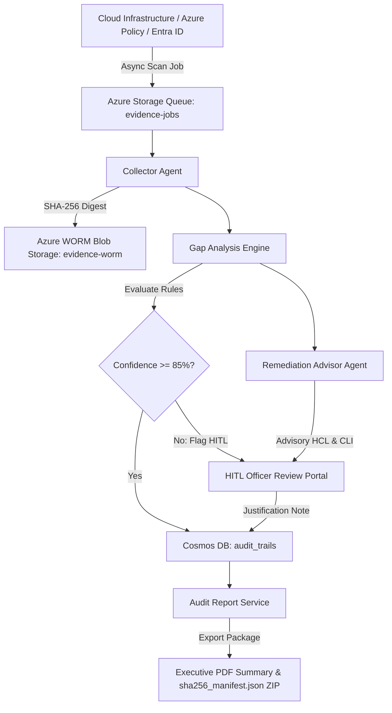

# ComplianceIQ 🛡️

**Agentic AI Compliance Automation and Audit Evidence Platform**

ComplianceIQ is an enterprise-grade, multi-agent AI platform designed to continuously monitor cloud infrastructure, codebase configurations, operational policies, and machine learning model lifecycles against major global regulatory frameworks: **SOC 2 Type II**, **EU Artificial Intelligence Act**, **ISO/IEC 27001:2022**, and **GDPR**.

Built with a **zero-trust architecture**, ComplianceIQ combines continuous evidence collection, deterministic + LLM rule evaluation, cryptographic WORM storage immutability, human-in-the-loop audit overrides, zero-hallucination Policy Q&A RAG, and automated executive PDF audit readiness packages.

---

## 🌟 Key Architecture & Safety Guardrails

ComplianceIQ is engineered around three non-negotiable safety guardrails to ensure regulatory compliance without risking production instability or AI hallucinations:

### 🛡️ Guardrail 1: Advisory-Only Remediation Engine
- Automatically generates **Terraform HCL (`azurerm`) code snippets** and **Azure CLI commands** for non-compliant controls.
- **Never auto-applies infrastructure mutations**. All remediation scripts are advisory and require human DevOps review before deployment.

### 🛡️ Guardrail 2: Confidence Threshold HITL Fallback
- Every control evaluation produces an **AI Confidence Score** ($0.00 - 1.00$).
- Any evaluation with confidence $< 85\%$ is automatically flagged for **Human-in-the-Loop (HITL) Officer Review**.
- Compliance Officers must provide a mandatory justification note (minimum 15 characters) to confirm or override AI determinations.

### 🛡️ Guardrail 3: Zero-Hallucination Policy Q&A RAG Service
- Powered by **PostgreSQL `pgvector` HNSW similarity search** over regulatory control text and policy embeddings.
- Every answer is strictly grounded in retrieved vector contexts and includes explicit regulatory framework citations.

---

## 🏗️ System Architecture & Workflow



---

## 📁 Repository Topology

```text
ComplianceIQ/
├── apps/
│   └── hitl_portal/          # Next.js 14 HITL Compliance Officer Review Portal
│       ├── app/              # App Router layout, globals.css design system, and dashboard page
│       ├── components/       # DashboardMetrics, HITLQueueTable, EvidenceReviewModal, PolicyChatDrawer
│       └── Dockerfile        # Production Next.js container image
├── database/
│   ├── schema.sql            # PostgreSQL DDL with pgvector extension & HNSW vector indexes
│   ├── seed_data.sql         # Seed regulatory controls (SOC 2, EU AI Act, ISO 27001, GDPR)
│   └── cosmos_audit_trails.json # Cosmos DB schema for append-only audit trail documents
├── services/
│   ├── collector_agent/      # Async Queue-driven Evidence Collector (Azure Policy, Entra ID, Storage Immutability)
│   ├── gap_analysis_agent/   # Deterministic & GPT-4o JSON mode rule evaluation engine
│   ├── remediation_advisor/  # Advisory Terraform HCL and Azure CLI generator
│   ├── policy_rag/           # PostgreSQL pgvector similarity search Policy Q&A engine
│   ├── orchestrator_api/     # FastAPI OpenAPI 3.0 API Gateway & Azure Queue Publisher
│   └── audit_report_service/ # ReportLab PDF Executive Audit Summary & SHA-256 ZIP Exporter
├── terraform/                # Infrastructure as Code (Azure Student $0 Free Tier)
│   └── modules/
│       ├── storage/          # Azure Storage Account, Storage Queue, WORM Container
│       ├── postgres/         # PostgreSQL Flexible Server (B1ms) + pgvector
│       ├── cosmos/           # Azure Cosmos DB (Free Tier 1000 RU/s)
│       ├── identity/         # Azure User-Assigned Managed Identity & Role Assignments
│       └── container_apps/   # Azure Container Apps Environment & Containers
├── tests/                    # Monorepo Integration Test Suite (46/46 Passed)
├── .github/workflows/        # GitHub Actions CI/CD Pipeline
├── requirements.txt          # Global Python dependencies
└── package.json              # Monorepo root workspace configuration
```

---

## ⚙️ Environment Configuration (`.env`)

Create a `.env` file in the project root containing your cloud credentials:

```env
# Azure Cloud Credentials & Storage
AZURE_STORAGE_ACCOUNT_NAME=
AZURE_STORAGE_QUEUE_NAME=
AZURE_STORAGE_CONTAINER_NAME=
AZURE_STORAGE_CONNECTION_STRING=

# PostgreSQL Database (pgvector Enabled)
DATABASE_HOST=
DATABASE_PORT=
DATABASE_NAME=
DATABASE_USER=
DATABASE_PASSWORD=
DATABASE_URL=

# Azure Cosmos DB (Append-Only Audit Trails)
COSMOS_DB_ENDPOINT=
COSMOS_DB_PRIMARY_KEY=
COSMOS_DB_DATABASE_NAME=
COSMOS_DB_CONTAINER_NAME=

# OpenAI LLM Engine (Optional for Live GPT-4o Agent Evaluation)
OPENAI_API_KEY=
OPENAI_MODEL=
```

---

## 🚀 Local Quickstart Guide

### Prerequisites
- **Python**: 3.11+
- **Node.js**: 18.0+ / 20.0+
- **Azure CLI**: 2.50+
- **Docker Desktop**: Optional for container builds

### 1. Repository Setup & Dependencies
```bash
# Clone the repository
git clone https://github.com/sainiharshit322/Compliance-IQ.git
cd Compliance-IQ

# Set up Python virtual environment
python -m venv venv
.\venv\Scripts\activate      # Windows
source venv/bin/activate     # Linux / macOS

# Install Python dependencies
pip install -r requirements.txt

# Install Node.js frontend dependencies
cd apps/hitl_portal
npm install
cd ../..
```

### 2. Running Automated Unit & Integration Tests
Run the monorepo test suite (46 passed tests):
```bash
.\venv\Scripts\pytest
```

### 3. Running Backend FastAPI Orchestrator API Gateway
Start the FastAPI backend server:
```bash
.\venv\Scripts\python -m uvicorn services.orchestrator_api.main:app --reload --port 8000
```
👉 Interactive Swagger UI API Docs: **`http://localhost:8000/docs`**

### 4. Running Next.js 14 HITL Compliance Portal
In a second terminal, start the Next.js development server:
```bash
cd apps/hitl_portal
npm run dev
```
👉 Next.js Compliance Portal: **`http://localhost:3000`**

---

## 🌐 OpenAPI 3.0 REST Gateway Reference

| HTTP Method | Endpoint Path | Description |
| :--- | :--- | :--- |
| `GET` | `/health` | Service health status check |
| `GET` | `/api/v1/frameworks` | List active regulatory compliance frameworks |
| `POST` | `/api/v1/scan` | Enqueue async evidence scan job into Azure Storage Queue |
| `GET` | `/api/v1/controls/{id}/evidence` | Retrieve raw evidence logs, WORM URIs, & SHA-256 digests |
| `GET` | `/api/v1/gaps` | List non-compliant controls, risk scores, & advisory HCL |
| `POST` | `/api/v1/chat` | Query Policy Q&A RAG agent (supports JSON or SSE token stream) |
| `GET` | `/api/v1/reports/download/{job_id}` | Download Audit Readiness Package (`.zip` containing PDF + JSON manifest) |
| `POST` | `/api/v1/scan-jobs/execute` | Execute synchronous end-to-end multi-agent pipeline |

---

## ☁️ Cloud Deployment (Terraform & Azure Container Apps)

### Infrastructure Provisioning via Terraform
```bash
cd terraform
terraform init
terraform plan
terraform apply
```

### GitHub Actions CI/CD Pipeline
Every `git push` to `master` triggers `.github/workflows/deploy.yml`:
1. Runs `pytest` monorepo test suite & Next.js production build verification.
2. Builds custom Docker container images directly on the runner.
3. Publishes images to **GitHub Container Registry (`ghcr.io`)**.
4. Updates **Azure Container Apps** (`ca-orchestrator-api-dev` & `ca-hitl-portal-dev`) in region **Korea Central (`koreacentral`)**.

---

## 📜 License & Compliance Disclaimer

This project is licensed under the **MIT License**. ComplianceIQ outputs advisory remediation code and AI risk evaluations; final regulatory compliance certifications remain subject to official accredited third-party audit verification.
